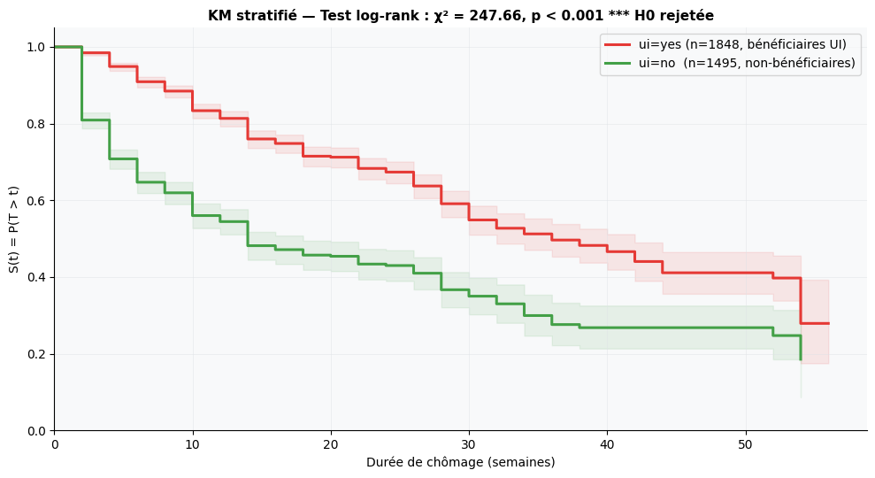
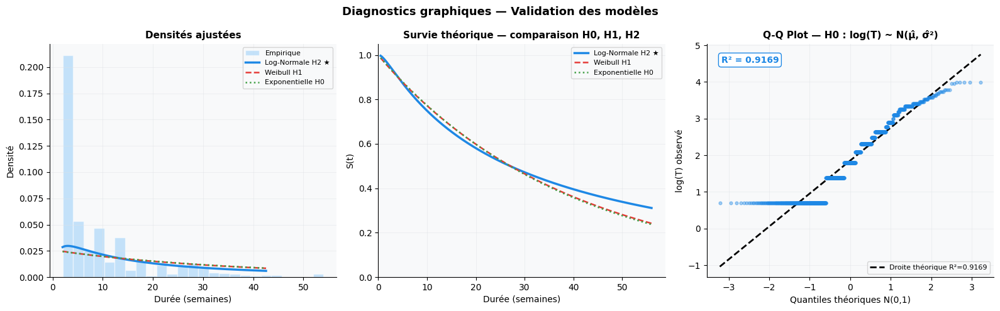
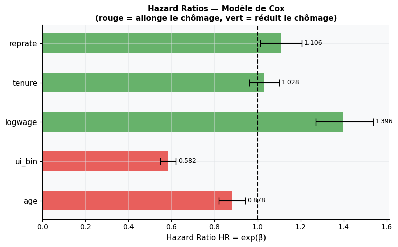
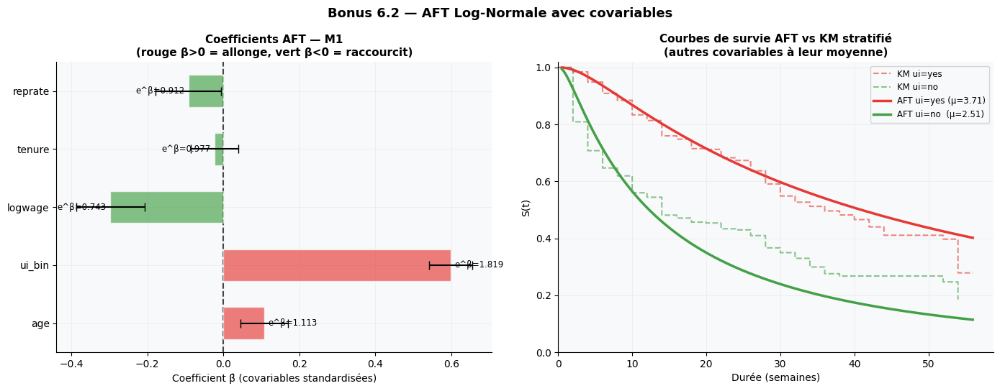

# ⏱️ Durée de chômage aux États-Unis — Analyse de survie

> Combien de temps un travailleur américain reste-t-il au chômage avant de retrouver un emploi à temps plein ? Quel rôle jouent l'assurance chômage et les caractéristiques individuelles ?

Projet de statistique inférentielle (ESSAI) : modélisation paramétrique de durées **censurées à droite** par maximum de vraisemblance, implémentée **from scratch** avec NumPy / SciPy (L-BFGS-B, Hessien numérique), puis comparée aux méthodes non paramétriques et semi-paramétriques.

---

## 📊 Données

- **Source :** `UnempDur` (McCall, 1996, *Econometrica*), package R `Ecdat` / [Rdatasets](https://vincentarelbundock.github.io/Rdatasets/doc/Ecdat/UnempDur.html)
- **Taille :** n = 3 343 travailleurs américains ayant perdu leur emploi (années 1990)
- **Événement :** retour à l'emploi à temps plein (`censor1 = 1`) → **32,1 %** d'événements, **67,9 % de censure**
- **Durée :** `T = spell × 2` semaines, de 2 à 56 (données groupées par intervalles de 2 semaines)

| Variable | Description |
|---|---|
| `ui` | Bénéficie de l'assurance chômage (oui / non) |
| `age` | Âge |
| `logwage` | Log du salaire hebdomadaire avant chômage |
| `tenure` | Ancienneté dans l'emploi précédent |
| `reprate` | Taux de remplacement des indemnités |

---

## 🧭 Démarche

1. **Analyse préliminaire** : censure massive et forte asymétrie (skewness ≈ 1,7) → OLS invalide, analyse de survie nécessaire.
2. **Estimation MLE** (vraisemblance avec censure à droite) de trois modèles emboîtés : Exponentielle (H₀), Weibull (H₁), Log-Normale (H₂).
3. **Validation** : AIC/BIC, KS, Anderson-Darling, Q-Q plot, Kaplan-Meier (IC de Greenwood), log-rank, Cox, test de Schoenfeld.
4. **Améliorations** : bootstrap paramétrique, MLE discret vs continu, modèle **AFT Log-Normale** avec covariables et interaction `ui × reprate`.
5. **Limites** : censure informative, hétérogénéité non observée (frailty), discrétisation, causalité.

---

## 🔑 Résultats principaux

### Choix du modèle de base

| Modèle | LogL | AIC | BIC |
|---|---:|---:|---:|
| Exponentielle | −5002,13 | 10 006,26 | 10 012,37 |
| Weibull (k̂ = 0,987) | −5001,99 | 10 007,98 | 10 020,21 |
| **Log-Normale** ★ | **−4930,62** | **9 865,24** | **9 877,47** |

- Test LR Exp vs Weibull : p = 0,60 → Weibull ≈ Exponentielle (k̂ ≈ 1), le hazard constant n'explique pas les données.
- **Log-Normale** : μ̂ = 3,298, σ̂ = 1,480, durée médiane ≈ **27 semaines** (IC 95 % [25,0 ; 29,3]), hazard en cloche (pic ≈ 3 semaines).
- ΔAIC > 140 en faveur de la Log-Normale.

### Effet de l'assurance chômage

- **Log-rank** : χ² = 247,7 (p < 0,001). Médiane observée de 10 semaines avec UI contre 4 sans.
- **Cox** : HR(ui) = 0,58 (−42 % de hazard de retour à l'emploi). Âge ↓, salaire ↑, `tenure` non significatif.
- **Schoenfeld** : seule `ui` viole la proportionnalité des risques → motive le modèle AFT.

### Modèle AFT Log-Normale (M2, retenu)

| Modèle | Paramètres | AIC |
|---|:---:|---:|
| M0 : sans covariables | 2 | 9 865,24 |
| M1 : AFT covariables | 7 | 9 429,47 |
| **M2 : + interaction ui × reprate** ★ | 8 | **9 421,33** |

- Bénéficier de l'UI **multiplie la durée médiane par ≈ 1,8** (aléa moral, Meyer 1990).
- Un salaire plus élevé raccourcit la durée ; l'âge l'allonge.
- L'interaction `ui × reprate` est significative (p = 0,0015).

### Bootstrap paramétrique (B = 500)

Biais du MLE négligeable (μ : −0,001 ; σ : +0,0004) ; IC bootstrap légèrement plus étroits que les IC du Hessien.

---

## 🖼️ Aperçu

| Kaplan-Meier stratifié par UI | Diagnostics d'ajustement |
|:---:|:---:|
|  |  |

| Hazard ratios (Cox) | Modèle AFT |
|:---:|:---:|
|  |  |

---

## 🚀 Reproduire

```bash
git clone https://github.com/maissaa655/chomage-analyse-survie.git
cd chomage-analyse-survie
pip install -r requirements.txt
```

1. Télécharger [`UnempDur.csv`](https://vincentarelbundock.github.io/Rdatasets/csv/Ecdat/UnempDur.csv) et le placer dans `data/`.
2. Dans le notebook, adapter le chemin de lecture (cellule de chargement) :
   ```python
   df_raw = pd.read_csv('data/UnempDur.csv')
   ```
3. Lancer `jupyter notebook notebooks/projet_stat_inf.ipynb`.

---

## 📁 Structure

```
├── notebooks/projet_stat_inf.ipynb   # analyse complète
├── images/                           # figures utilisées dans ce README
├── data/                             # UnempDur.csv (à télécharger)
├── requirements.txt
└── README.md
```

---

## ⚠️ Limites

- Censure potentiellement **informative** (temps partiel et autres sorties traités comme censurés) → un modèle à risques concurrents serait plus rigoureux.
- **Hétérogénéité non observée** non modélisée (frailty) : σ̂ probablement surestimé.
- Données **groupées** (pas de 2 semaines) approximées par un modèle continu.
- Données des années 1990, effets **associatifs** et non causaux.

---

## 📚 Références

- McCall, B.P. (1996). Unemployment insurance rules, joblessness, and part-time work. *Econometrica*.
- Cox, D.R. (1972). Regression models and life tables. *JRSS B*.
- Kaplan, E.L. & Meier, P. (1958). Nonparametric estimation from incomplete observations. *JASA*.
- Meyer, B.D. (1990). Unemployment insurance and unemployment spells. *Econometrica*.
- Lancaster, T. (1979). Econometric methods for the duration of unemployment. *Econometrica*.
- Kiefer, N.M. (1988). Economic duration data and hazard functions. *Journal of Economic Literature*.

---

## 👤 Auteure

**Maissa** ([@maissaa655](https://github.com/maissaa655)) : étudiante à l'ESSAI (Université de Carthage), double diplôme ENSAE Paris. Data science appliquée à la finance, l'actuariat et l'économie.
